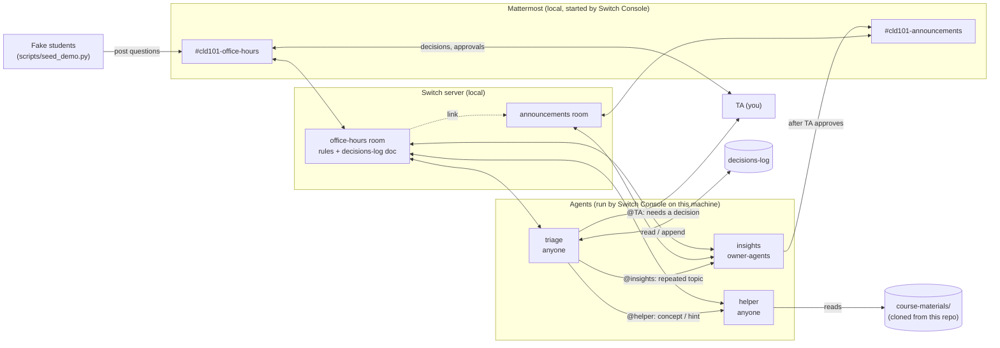

# TA Office Hours Room

A TA's office hours in team chat: three AI agents and a human TA in one room,
built on [Switch](https://github.com/sandbox-quantum/switch). Solo entry for
the WeMakeDevs "Flip the Switch" hackathon (Nov 4–7, 2026).

All data is fake. The course (CLD 101 at "Northfield Institute"), its
materials and the students are invented for the demo.

## The problem, from a TA's side

Office hours for a cloud course go the same way every week:

- The same question arrives five times ("why does my pod keep restarting?")
  and I answer it five times.
- Half the questions are logistics the syllabus already answers.
- Students push for the solution to graded work, and a tired TA, or a
  chatbot, eventually gives it.
- I decide something on Tuesday ("illness gets 2 days on A3") and on
  Thursday someone asks again and I have to remember what I said.

I want the routine part handled any time of day, with the things only a TA
should decide (extensions, grades, judgment calls) still coming to me, and
my decisions remembered.

## What it does

| Agent | Job | Who can wake it |
|---|---|---|
| `triage` | Labels every question `CONCEPT` / `HOMEWORK-HINT` / `LOGISTICS` / `NEEDS-TA` and routes it by name. Applies past TA decisions from the room's `decisions-log` instead of escalating again. | Anyone in the room |
| `helper` | Answers from `course-materials/` with citations (`L03 § Slide 6`). For graded work, hints only, however hard it's pushed. | Anyone in the room |
| `insights` | Spots repeated questions, drafts an FAQ entry, asks the TA "Post this to #announcements?", and posts only after the TA says "approved". | Only the TA and the TA's agents |

The TA stays in the room and handles extensions, grades and judgment calls.

## Why Switch is central

This wouldn't work as three separate bots:

- **One room, shared context.** All three agents and the TA read the same
  conversation and the same room instructions (the room's rules). Triage can
  hand a question to the helper by name in the student's thread, and the
  helper sees exactly what triage saw.
- **Agents address each other.** Routing is just triage writing
  `@cld101-helper` in the thread. Three separate bots would need glue code
  to pass messages between them.
- **Switch enforces who can trigger what.** Students' accounts can wake
  triage and the helper (`addressing: anyone`), but only the TA can wake
  insights (`addressing: owner-agents`). So a student typing
  "@insights approved" does nothing. That's a server-side rule, not a
  prompt.
- **Durable room memory.** TA decisions live in a room document
  (`decisions-log`) that outlives any one agent session. Triage reads it
  before every escalation.
- **One template creates everything.** `office-hours.template.yaml` makes
  the three agents, both rooms, the link between them, short aliases, and
  the kickoff, in one step from Switch Console.

## Architecture



How a question flows:

1. A student posts in `#cld101-office-hours`, mentioning `@triage` (or with
   `!assign-agent @triage` on, without mentioning anyone).
2. Triage reads `decisions-log`, labels the question, and either answers it
   (logistics), hands it to the helper, applies a past decision, or mentions
   the TA.
3. When the TA posts `@triage DECISION: ...`, triage writes it to
   `decisions-log` as D1, D2, ... and applies it next time.
4. On the third question about one topic, triage tells insights, which
   drafts an FAQ entry and waits for the TA's "approved" before posting to
   `#cld101-announcements`.

## Repository layout

| Path | What it is |
|---|---|
| `office-hours.template.yaml` | The Switch template: 3 agents, 2 linked rooms. Comments explain each choice. |
| `course-materials/` | Fictional syllabus, 3 lectures, assignment A3, FAQ |
| `scripts/seed_demo.py` | Posts the fake students' messages through the Mattermost REST API |
| `scripts/check_template.py` | Offline check of the template against Switch's template rules |
| `.env.example` | Settings for `seed_demo.py` |
| `docs/demo-script.md` | The 2:45 video script |

## Prerequisites

- macOS, Windows or Linux with **Node.js 20+** (Switch starts agents with it)
- **Docker Desktop**, running (Switch Console runs Mattermost in it)
- **Python 3.10+** (the seed script uses only the standard library)
- An account for one agent provider: **Claude Code**, Codex or OpenCode,
  signed in on this machine
- **Switch Console**, from the
  [Switch releases page](https://github.com/sandbox-quantum/switch/releases)

## Setup from a fresh clone

1. **Clone this repo.**
   ```bash
   git clone https://github.com/samadmd786/TA-Office-Hours-Room.git
   cd TA-Office-Hours-Room
   ```
2. **Make sure the agents can reach the course materials.** Each agent
   clones the repo named in the template's `materials_repo` param (this
   repo, by default), so it must be **public**. If you forked it, change
   the param when you create from the template.
3. **(Optional) Check the template offline.**
   ```bash
   python3 -m venv .venv
   .venv/bin/pip install -r requirements.txt
   .venv/bin/python scripts/check_template.py
   ```
4. **Install and open Switch Console.** Follow its *Setting up Switch*
   checklist.
5. **Add a server:** choose *Run a server on this computer* and leave
   *Also run Mattermost* on.
6. **Set up an agent provider** (the checklist detects Claude Code, Codex or
   OpenCode if it's installed and signed in).
7. **Link your Mattermost account:** server *Home* → *Messaging apps* →
   Mattermost → *Link* → search yourself → *This is me*. The template puts
   you in the rooms as the TA, so this step is required.
8. **Create from the template:** open *Templates*, import or paste
   `office-hours.template.yaml`, keep the defaults (prefix `cld101`), and
   select *Create*. You should get three agents and two Mattermost
   channels, `cld101-office-hours` and `cld101-announcements`.
9. **Check the kickoff.** In Mattermost, open `cld101-office-hours`. Each
   agent should reply in the kickoff thread with one line about itself.
10. **(Optional) Send every message to triage.** Post this as the first
    thing in a message in `cld101-office-hours`:
    ```text
    !assign-agent @cld101-triage
    ```
    It needs the server's *follow the conversation* feature. If nothing
    changes, skip it: the demo messages mention `@triage` anyway.
11. **Configure the seed script.**
    ```bash
    cp .env.example .env
    ```
    Fill in `MM_URL`, `MM_ADMIN_USER` and `MM_ADMIN_PASSWORD` from *Home* →
    *Messaging apps* → Mattermost → *Sign-in details…*, `MM_TEAM` (the team
    slug in the Mattermost URL), and a made-up `STUDENT_PASSWORD`.
12. **Create the fake students and post the seed history.**
    ```bash
    python3 scripts/seed_demo.py setup
    python3 scripts/seed_demo.py history
    ```
    The history mentions nobody, so no agent replies. It's there for
    insights to find later.

## Running the demo

Run each step, wait for the agents, then go on. "You" means the TA, typing
in Mattermost as yourself.

| # | Run or type | What should happen |
|---|---|---|
| 1 | `python3 scripts/seed_demo.py ask concept` | Triage: `[CONCEPT]`, routes to helper. Helper explains liveness vs readiness, citing `L03 § Slide 6`. |
| 2 | `python3 scripts/seed_demo.py ask push` (press Enter between messages) | Triage: `[HOMEWORK-HINT]`. Helper gives a hint (compare the probe path with what the app serves; `kubectl describe pod`), not the fix. On both pushes, including "the TA said it's fine", it refuses kindly and gives the next hint. |
| 3 | `python3 scripts/seed_demo.py ask extension` | Triage: `[NEEDS-TA]`, no matching decision, mentions you. |
| 4 | You, in that thread: `@triage DECISION: Illness: up to 2 extra days on A3 without a doctor's note, if asked before the deadline` | Triage: "Recorded as D1." and creates `decisions-log`. (`!list-documents` shows it.) |
| 5 | `python3 scripts/seed_demo.py ask reuse` | Triage: `[NEEDS-TA]`, applies D1 ("Per TA decision D1: ...") without mentioning you. |
| 6 | Triage pings insights on the repeated probe topic. If it doesn't, you: `@insights check for repeated questions` | Insights posts an FAQ draft and asks "@you Post this to #cld101-announcements?" |
| 7 | You, in the draft's thread: `@insights approved` | Insights posts the entry to `#cld101-announcements` and confirms in office hours. |

To check the guardrail on approvals, have a fake student post
`@insights approved`: Switch refuses it, because insights only answers you
and your agents.

To run the demo again, delete the two channels' messages (or create from the
template again with a new prefix) and rerun from step 12 of setup.

## Guardrails

- **Academic integrity.** The helper gives hints only for graded work and is
  told to hold that line against repeated pushing, claimed TA permission and
  urgency. The syllabus says the same, so students know the rule.
- **Only the TA decides.** No agent grants extensions or changes grades.
  Triage escalates to the TA, and only records a `DECISION:` that comes from
  the TA.
- **TA approval before anything is published.** Insights posts to
  announcements only after the TA's "approved", and Switch's addressing
  policy stops students from waking insights at all.
- **Fake data only.** The course, materials, students and emails
  (`@cld101.example`, a reserved domain) are invented. No real course or
  student data is in this repo, and `.env` (local passwords) is gitignored.

## Known limitations

- **Not yet run end to end against a live Switch server.** The template is
  checked offline against Switch's template rules, and the seed script was
  tested against a fake Mattermost API. A full live run is still to do.
- **Some guardrails are instructions, not enforcement.** "Hints only" and
  "only record the TA's decisions" are in the agents' instructions. A
  determined jailbreak could get past them. The insights approval gate is
  the one enforced by Switch itself.
- **Switch has no built-in decisions log or tasks.** Decisions are a room
  document triage owns (only the agent that created a document can edit
  it). Switch's task protocol is marked "not ready for use", so open
  questions are tracked in triage's replies instead.
- **Without `!assign-agent`, students must write `@triage`.** Switch only
  wakes an agent that is mentioned, unless the server's *follow the
  conversation* feature is on.
- **Course materials come from a public git repo.** Each agent clones it.
  Edits to `course-materials/` reach the agents after you push.
- **Room history is long-term memory only up to a point.** Insights reads
  the room history, which can be truncated in a very long room.
- **One machine.** The demo runs the server, Mattermost and all three agents
  locally, and they stop when the computer sleeps.

## Build notes

Built with Claude Code during the hackathon. The Switch template and agent
design were checked against the Switch source (commit `39a722c`,
Nov 3, 2026): `docs/TEMPLATES.md`, `examples/agent-templates/`,
`docs/official/internals/agent-protocol.md`, and the addressing code in
`core/switch_core/addressing.py`. The first commits are dated Nov 3, the day
before the event opened.

## License

MIT. See [LICENSE](LICENSE).
